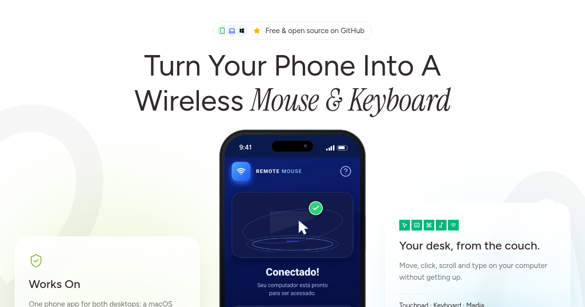
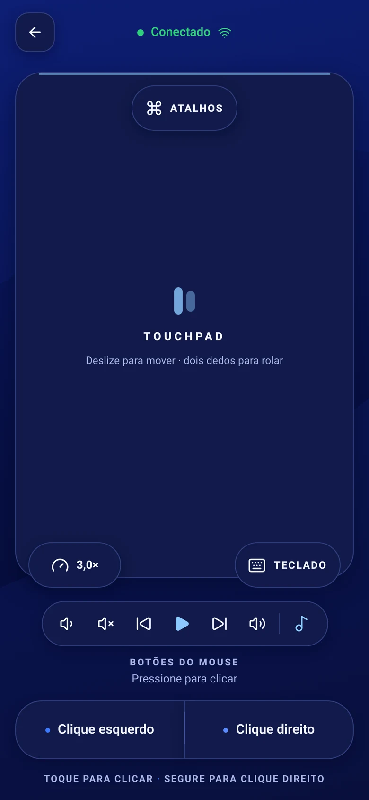
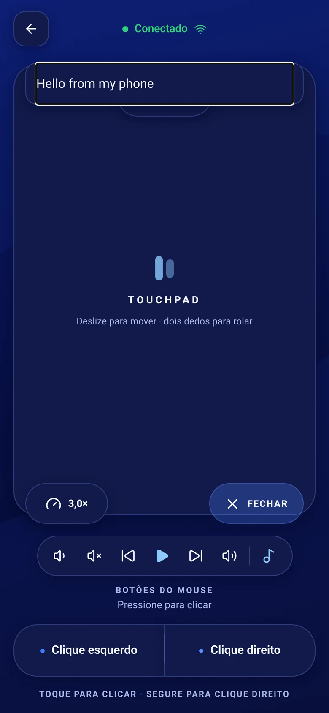
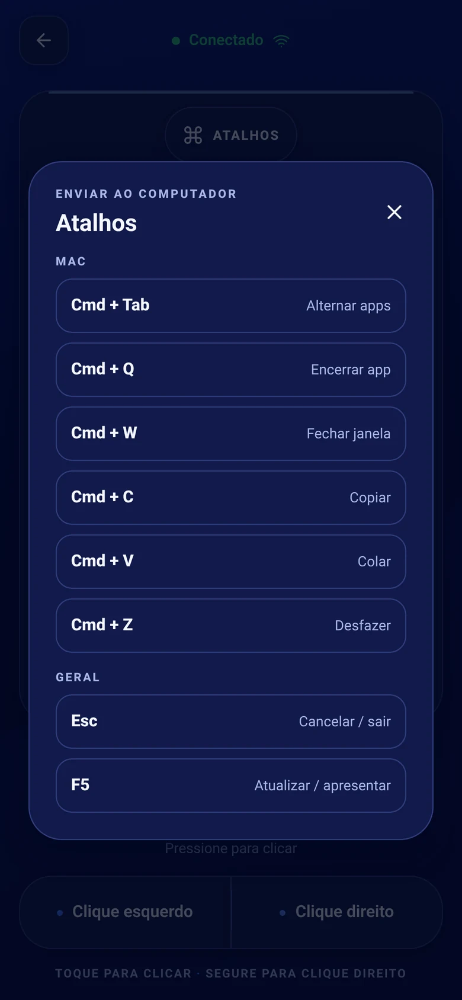
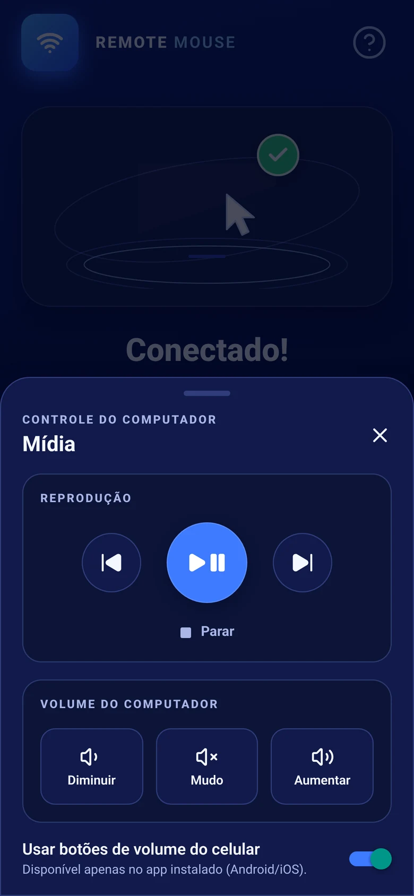
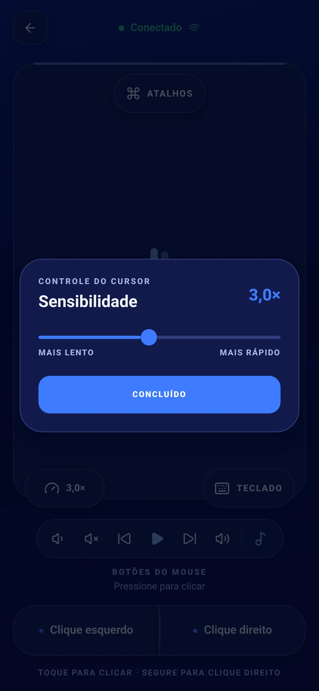

<p align="center">
  <a href="https://connectmouse.davixs.com.br"></a>
</p>

<h1 align="center">ConnectMouse</h1>

<p align="center"><b>Turn your phone into a wireless mouse and keyboard for your Mac or PC, over your own Wi-Fi.</b></p>

<p align="center">
  <a href="https://connectmouse.davixs.com.br"><b>Download</b></a> ·
  <a href="https://connectmouse.davixs.com.br">Website</a> ·
  <a href="#quick-start">Quick start</a> ·
  <a href="#features">Features</a> ·
  <a href="windows/README.md">Windows</a> ·
  <a href="macos/README.md">macOS</a> ·
  <a href="https://connectmouse.davixs.com.br/privacy/">Privacy</a>
</p>

<p align="center">
  <a href="LICENSE"></a>
  
  
  
  <a href="https://github.com/daviixs/wifi-mouse/stargazers"></a>
</p>

<p align="center">
  <a href="https://connectmouse.davixs.com.br"></a>
</p>

<p align="center">
  
</p>

The phone app (Expo / React Native) talks to a small Rust agent on your computer over a WebSocket on
your local network. The computer shows up by itself (mDNS), or you type its IP. Nothing goes through
the internet: no account, no cloud, no analytics. The agent runs inside a native tray app on Windows
and a menu bar app on macOS.

## Why ConnectMouse

- **Your desk, from the couch.** Move, click, scroll and type on the computer without getting up:
  touchpad, keyboard, shortcuts and media keys in one app.
- **Local only.** Phone and computer talk directly on your Wi-Fi (TCP `8765`, mDNS on UDP `5353`).
  No sign-up, no server in the middle. See the [privacy policy](https://connectmouse.davixs.com.br/privacy/).
- **Native and light.** A pure Win32 tray app on Windows (about 1 MB, no webview), SwiftUI on macOS,
  and one shared Rust agent behind both.
- **Fast by design.** Touch deltas are accumulated on the UI thread and sent at most once per frame,
  without re-rendering the screen on every move.

## Quick start

### Option 1: download from the website (recommended)

Go to **[connectmouse.davixs.com.br](https://connectmouse.davixs.com.br)** and download the phone app
and the desktop app for your computer (Windows or Mac). Then:

1. Open the desktop app and click **Start server** in the tray / menu bar. On Windows, allow
   **private networks** if the firewall asks. On macOS, allow the agent in **System Settings → Privacy
   & Security → Accessibility**.
2. **On the phone**, join the same Wi-Fi, open the app and pick your computer from the list (or type
   the IPv4 shown by the desktop app, e.g. `192.168.0.12:8765`). Tap **Connect**.

### Option 2: install or build manually

1. **On the computer**, run the desktop app:
   - **Windows:** the installer `ConnectMouse-Setup-<version>.exe` (built from
     [`windows/installer/`](windows/README.md#instalador-com-assistente-inno-setup)). A Microsoft Store
     version is coming soon.
   - **macOS:** the menu bar app and DMG from [`macos/`](macos/README.md) (macOS 13+).
   - **Any OS, from source:** `cd rust-agent && cargo run --release`.
2. Start the server and connect the phone as in steps 1 and 2 of Option 1. To run the phone app from
   source, see [Development](#development).

> The agent listens on `0.0.0.0:8765`, which means "all interfaces": don't type `0.0.0.0` on the
> phone, use the computer's Wi-Fi IPv4. Use trusted networks only (see [Security](#security)).

## Features

| Feature                | Status      | Notes                                                                                                                                                         |
| ---------------------- | ----------- | ------------------------------------------------------------------------------------------------------------------------------------------------------------- |
| Touchpad               | ✅          | One finger moves (`mouse.move`), tap is left click, long press is right click, two fingers scroll vertically and horizontally. Touch feedback while dragging. |
| Sensitivity            | ✅          | Cursor speed from `0.5×` to `3×`, saved on the phone. Affects movement only.                                                                                  |
| Keyboard               | ✅          | The phone's native keyboard types on the computer in real time, including Backspace and Enter.                                                                |
| Shortcuts              | ✅          | `keyboard.shortcut` with Ctrl, Alt, Shift and Meta plus Tab, Esc, arrows, F4, F5 and common letters (copy, paste, undo, new tab…).                            |
| Media and volume       | ✅          | `media.key`: volume up/down/mute, play/pause, next, previous, stop (no "stop" key on macOS).                                                                  |
| Phone volume buttons   | ✅ / Beta   | Android: the physical buttons control the computer's volume without changing the phone's. iOS: best effort (no public API). Can be turned off.                |
| Automatic discovery    | ✅          | The agent advertises `_remotemouse._tcp` over mDNS; the phone lists computers on the network and remembers the last one. Manual IP always works.              |
| Auto-reconnect         | ✅          | The WebSocket client reconnects with exponential backoff if the connection drops.                                                                             |
| Windows tray app       | ✅          | Native Win32 in Rust with the agent in-process: start/stop, status, IPs, copy address, Windows Firewall help, **Start with Windows**.                         |
| Windows installer      | ✅          | Inno Setup wizard: per-user install without admin, Start menu shortcut, "start with Windows" and firewall rules (all-users install).                          |
| Microsoft Store (MSIX) | Coming soon | MSIX manifest and packaging script are ready, with firewall rules and a startup task.                                                                         |
| macOS menu bar app     | ✅          | SwiftUI + AppKit, no Dock icon. Shows the real Accessibility permission of the agent that injects input.                                                      |
| Languages              | ✅          | Desktop apps in Brazilian Portuguese, English and Spanish, chosen from the system language.                                                                   |
| Website                | ✅          | Static Astro landing page and blog in [`website/`](website/README.md), live at [connectmouse.davixs.com.br](https://connectmouse.davixs.com.br).              |

<p align="center">
  
  
  
  
  
</p>

## Repository

| Path                                  | What it is                                                                                                                                                                                                                                                                 |
| ------------------------------------- | -------------------------------------------------------------------------------------------------------------------------------------------------------------------------------------------------------------------------------------------------------------------------- |
| [`src/`](src)                         | Expo Router phone app: `app` (routes: connect, connected, touchpad), `components`, `services/websocket` (persistent client, address, command queue, reconnect), `services/discovery`, `stores` (Zustand), `types` (versioned protocol shared with the agent), `constants`. |
| [`modules/`](modules)                 | Local Expo modules: `service-discovery` (mDNS) and `volume-keys` (physical volume buttons).                                                                                                                                                                                |
| [`rust-agent/`](rust-agent/README.md) | Lightweight agent for macOS and Windows, library + binary (CLI and macOS helper).                                                                                                                                                                                          |
| [`windows/`](windows/README.md)       | Native Win32 tray app, Inno Setup installer and MSIX/Store packaging.                                                                                                                                                                                                      |
| [`macos/`](macos/README.md)           | SwiftUI menu bar app, `.app` and DMG scripts.                                                                                                                                                                                                                              |
| [`website/`](website/README.md)       | Astro landing page, blog and privacy policy.                                                                                                                                                                                                                               |
| [`docs/`](docs)                       | Design notes.                                                                                                                                                                                                                                                              |

## Development

### Phone app

```sh
npm install
npm start
```

Press `i` or `a` in the Expo terminal for the iOS simulator or Android emulator. Native modules
(discovery, volume keys) need a development build (`npx expo run:android` / `run:ios`), not Expo Go.

### Rust agent

```sh
cd rust-agent
cargo run --release
# another address or port:
REMOTE_MOUSE_BIND=0.0.0.0:9000 cargo run --release
```

### Android release build (local)

`android/` is generated by Expo Prebuild and ignored by Git, so never edit it by hand.

```sh
export ANDROID_HOME="$HOME/Library/Android/sdk"
export ANDROID_SDK_ROOT="$ANDROID_HOME"

npx expo prebuild --platform android
cd android
export NODE_ENV=production
./gradlew :app:assembleRelease -PreactNativeArchitectures=arm64-v8a
```

The APK is written to `android/app/build/outputs/apk/release/app-release.apk`.

### Windows and macOS apps

- **Windows:** build, installer (`.\windows\installer\build-installer.ps1`), MSIX and Store steps are in
  [windows/README.md](windows/README.md).
- **macOS:** build, `.app`/DMG and permissions are in [macos/README.md](macos/README.md).

### Checks

```sh
npm run typecheck
npm run lint
npm run test:motion
npx expo-doctor
cargo test --locked --manifest-path rust-agent/Cargo.toml
cargo test --locked --manifest-path windows/Cargo.toml
```

## Protocol

Commands are versioned JSON text messages over WebSocket (port `8765`):

```json
{ "version": 1, "type": "mouse.move", "payload": { "dx": 12, "dy": -4 } }
```

| Type                | Payload                                                                                    |
| ------------------- | ------------------------------------------------------------------------------------------ |
| `mouse.move`        | `dx`, `dy` (pixels)                                                                        |
| `mouse.click`       | `button`: `left`, `right`, `middle`                                                        |
| `mouse.scroll`      | `dx`, `dy` (horizontal and vertical)                                                       |
| `keyboard.text`     | `text` typed on the phone                                                                  |
| `keyboard.key`      | `key`: `backspace`, `enter`                                                                |
| `keyboard.shortcut` | `modifiers` (`ctrl`, `alt`, `shift`, `meta`) and `key`                                     |
| `media.key`         | `key`: `volume_up`, `volume_down`, `volume_mute`, `play_pause`, `next`, `previous`, `stop` |

The source of truth is [`src/types/protocol.ts`](src/types/protocol.ts). The agent accepts one client
at a time, ignores binary frames, invalid JSON and unknown versions, and limits messages to 1 KiB.
Unknown media keys are rejected by the app and ignored (with a log) by the agent. Details in
[rust-agent/README.md](rust-agent/README.md).

While active, the app logs aggregated stats every five seconds as `[RemoteMouse][diag][app]` and the
agent logs receive/apply times and errors as `[RemoteMouse][diag][agent]`. These timings are local to
each device, not end-to-end latency.

## Security

There is no authentication, encryption or command acknowledgement yet: anyone on the same network
who can reach port `8765` while the server is running can send input. Use ConnectMouse on trusted
networks only (on Windows, keep your Wi-Fi as a **private** network), and stop the server when you
don't need it.

## License

ConnectMouse is released under the [MIT License](LICENSE).

## Community

Bugs and feature requests go in [issues](https://github.com/daviixs/wifi-mouse/issues). Pull requests
are welcome: run the [checks](#checks) before opening one.
