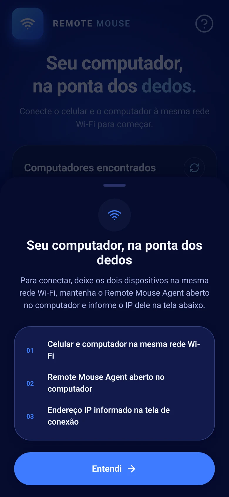

ConnectMouse works by running a small server on your computer and letting your phone talk to it directly over your local Wi-Fi. The desktop app announces the computer on the network with mDNS, the phone connects to it through a WebSocket on port **8765**, and every touch, keystroke or shortcut travels as a tiny JSON command. On the computer, the agent turns each command into a real mouse or keyboard event. Nothing goes through the internet or a cloud account.

This article explains each piece, from discovery to input injection, and is upfront about what the current version does and does not protect against. It is written for curious users and for developers who want to build on the protocol.

## What are the parts of ConnectMouse?

ConnectMouse is three programs that share one small protocol.

| Part | Runs on | Job |
| --- | --- | --- |
| Phone app | Android and iOS (React Native with Expo) | Turns gestures and typing into commands and sends them |
| Desktop agent | macOS and Windows (Rust) | Listens on port 8765, validates commands and injects input |
| Desktop app | macOS menu bar (SwiftUI) or Windows notification area (Win32) | Starts and stops the agent, shows status, addresses and permissions |

On a Mac, the menu bar app bundles the Rust agent as a helper process and controls it through private pipes, without opening another port. On Windows, the tray app runs the same agent inside its own process. In both cases the server only starts when you click **Start server**. The setup guides cover each platform step by step: [ConnectMouse on Mac](/blog/use-phone-as-mouse-for-mac/) and [ConnectMouse on Windows](/blog/use-phone-as-mouse-and-keyboard-windows-pc/).

## How does the phone find your computer?

When the server starts, the agent announces the computer with **mDNS / DNS-SD**, the same zero-configuration discovery printers and smart speakers use. The service type is `_remotemouse._tcp.local.` and the announcement carries three small TXT records:

- `name`: the computer's name, shown in the phone app
- `os`: `macos` or `windows`, so the app can show the right shortcuts
- `version`: the protocol version, currently `1`

The phone app lists every computer it finds and picks the first usable IPv4 address for each one, skipping loopback and link-local addresses. It also remembers the last computer you used.

Discovery is a convenience, not a requirement. If a router, a firewall or a corporate network blocks mDNS, the server keeps running and you can type the computer's IP address into the phone instead. The desktop apps show those addresses and a **Copy address** button for exactly this case.


*The phone app explains the three requirements: the same Wi-Fi, the desktop app open and the right address.*

## What travels between your phone and your computer?

The connection is a WebSocket, a long-lived two-way channel, opened from the phone to `your-computer-ip:8765`. Each message is a small JSON text object with a version, a type and a payload:

```json
{ "version": 1, "type": "mouse.move", "payload": { "dx": 12, "dy": -4 } }
```

Version 1 of the protocol has seven command types:

| Command | Payload | Example use |
| --- | --- | --- |
| `mouse.move` | `dx`, `dy` | Dragging one finger |
| `mouse.click` | `button`: left, right or middle | Tap or long press |
| `mouse.scroll` | `dx`, `dy` | Two-finger scrolling |
| `keyboard.text` | `text` | Typing letters and words |
| `keyboard.key` | `backspace` or `enter` | Deleting and submitting |
| `keyboard.shortcut` | `modifiers` (ctrl, alt, shift, meta) and `key` | Cmd + Tab, Alt + F4 |
| `media.key` | volume up, down, mute, play/pause, next, previous, stop | Media panel and volume buttons |

After the connection opens, the agent sends one message back, a `server.info` greeting with its operating system. That is how the phone shows Mac shortcuts with **Cmd** for a Mac and **Ctrl / Alt** shortcuts for a PC, even when you connected by typing the address.

<div class="callout callout-info"><p><strong>Built to fail safe:</strong> each WebSocket frame and message is limited to 1 KiB. The agent ignores binary messages, invalid JSON, unknown versions and unknown keys instead of guessing. Long text is split into chunks under that limit before it is sent.</p></div>

## How does a finger movement become a cursor movement?

The touchpad has to feel immediate, so the phone app avoids work on the JavaScript thread while your finger moves. Gestures are tracked on the UI thread with Reanimated, which adds up the tiny movement deltas and dispatches them at most once per frame. Each batch goes out over the WebSocket right away; commands are only merged when several are already waiting in the queue, for example after a brief network hiccup.

The sensitivity setting, from 0.5× to 6×, multiplies those deltas on the phone. If the connection drops, the app reconnects automatically with an increasing delay between attempts.

### How does typing work without a key-by-key API?

Mobile keyboards do not report individual key presses reliably, especially with autocorrect, accents and keyboards like Gboard. ConnectMouse takes a sturdier route: it watches a text field and compares the new text with the previous one. A new letter becomes `keyboard.text`, a deletion becomes `keyboard.key` with `backspace`, and an autocorrected word becomes the right number of backspaces followed by the replacement. Enter is sent when you submit the field. Shortcuts skip the text field entirely and are sent as `keyboard.shortcut` commands.

## How does the computer turn commands into real input?

The Rust agent uses the open-source **enigo** library to create operating system input events. On Windows those are standard input events sent with `SendInput`; on macOS they are system events that require the Accessibility permission.

That is why the setup on each platform has one important step:

- **macOS:** you approve the app in **System Settings → Privacy & Security → Accessibility**. The ConnectMouse menu bar app checks the permission of the actual agent and keeps the dashboard locked until it is granted.
- **Windows:** no special permission is needed, but Windows' User Interface Privilege Isolation keeps a normal app from controlling elevated windows like Task Manager or UAC prompts. ConnectMouse is designed to run without administrator rights.

The agent serves one phone at a time and does not send an acknowledgement for each command, which keeps the channel light.

## Is ConnectMouse private and safe to use?

Here is what you get, and what you do not get yet, in plain terms.

**What stays private:**

- **No cloud, no account.** The phone talks directly to your computer on the local network. There is no ConnectMouse server, no sign-up and no analytics library in the apps.
- **Nothing is read from the computer.** The agent does not capture your screen or record keystrokes. It only receives commands and turns them into input. Camera, screen recording and input monitoring permissions are not needed on Mac.
- **Off by default.** The desktop server starts only when you click **Start server** and stops when you stop it or quit the app.
- **Local diagnostics.** Timing statistics are printed to each device's own log for troubleshooting and are not sent anywhere.

**What the current version does not do:**

- There is **no pairing code, authentication or encryption** on the WebSocket yet. Anyone who can reach port 8765 on the same network could send mouse and keyboard commands while the server runs.

That makes the network you use the real security boundary. A few habits cover it:

1. Use ConnectMouse on networks you trust, such as home or a private office network.
2. Click **Stop server** or quit the app before joining public Wi-Fi.
3. On Windows, keep untrusted networks set to **Public**. ConnectMouse is meant to be allowed on private networks only, and the Microsoft Store package limits its firewall rules to private and domain networks.
4. Never forward port 8765 on your router or expose it to the internet.

<div class="callout callout-warning"><p><strong>Why say this out loud?</strong> Because a remote control for your computer deserves an honest threat model. Pairing and an encrypted connection are not part of this version; the project documentation lists them as not implemented.</p></div>

## Can developers build on the ConnectMouse protocol?

Yes. The protocol is defined in one TypeScript file shared by the app, `src/types/protocol.ts`, and implemented by the Rust agent in `rust-agent`. Both live in the [ConnectMouse repository on GitHub](https://github.com/daviixs/wifi-mouse). You can run the agent on its own with `cargo run --release`, change the listening address with the `REMOTE_MOUSE_BIND` environment variable and send it JSON commands from any WebSocket client on your network. Bugs and ideas go to [GitHub Issues](https://github.com/daviixs/wifi-mouse/issues).

## Simple on the outside, transparent on the inside

ConnectMouse is deliberately small: one port, seven commands, no cloud. That is what makes the touchpad feel direct and what lets you check exactly what it does. Get the phone app, start the desktop app on your [Mac](/blog/use-phone-as-mouse-for-mac/) or [Windows PC](/blog/use-phone-as-mouse-and-keyboard-windows-pc/), and take control of your computer from across the room.
