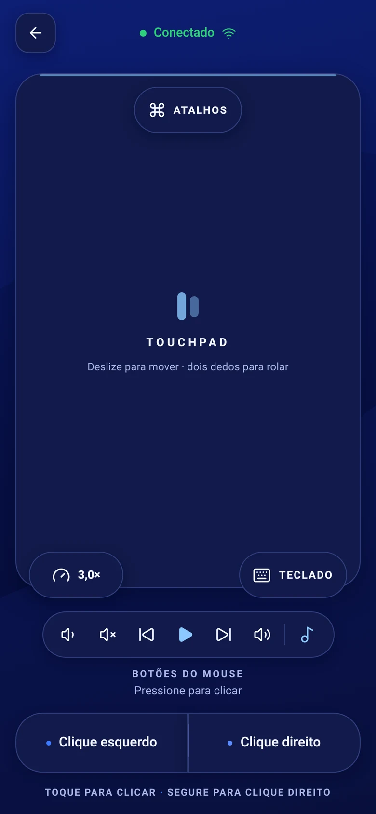
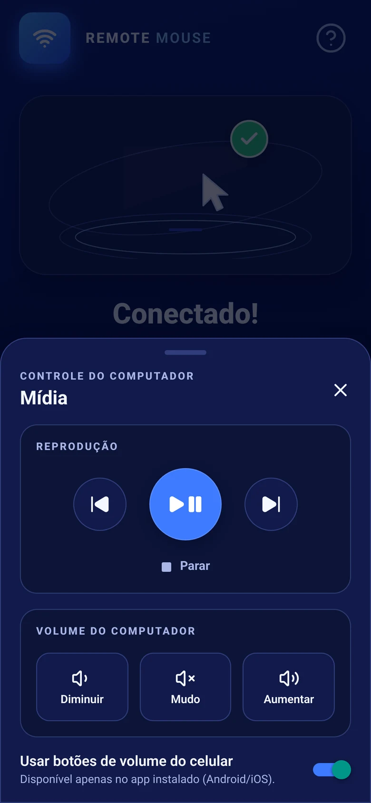

To use your phone as a mouse and keyboard on a Windows PC, install the ConnectMouse tray app on Windows and the ConnectMouse app on your phone. Click the mouse icon next to the clock, choose **Start server** and allow the app on **private networks** when Windows Firewall asks. Keep the phone on the same Wi-Fi network, select your PC in the phone app, and you can move the pointer, type, scroll and fire shortcuts like **Alt + Tab** from your hand.

This guide covers Windows 10 and Windows 11, explains the firewall step that trips up most people and lists the few things Windows does not let any app control.

## What do you need to control a PC from your phone?

- **Windows 10 version 1809 or later, or Windows 11.** The app is built for x64 PCs, with an optional ARM64 build.
- **An Android phone or iPhone** with the ConnectMouse app installed.
- **The same Wi-Fi network on both devices,** with the PC's network set to **Private** (more on that below).
- **No administrator rights.** ConnectMouse runs as a normal app and should never be run as administrator.

There is no account to create, no Bluetooth pairing and no cable. The phone sends commands straight to the PC over your local network. If you want to understand exactly what that means for privacy, see [how ConnectMouse works over local Wi-Fi](/blog/how-connectmouse-works-local-wifi-privacy/).

## How do you install the ConnectMouse tray app on Windows?

ConnectMouse for Windows is a native Win32 app of around 1 MB. It does not use Electron, Tauri or a web view, and it lives in the notification area next to the clock instead of on the taskbar.

There are two ways to install it:

| Option | Best for | What to know |
| --- | --- | --- |
| [Microsoft Store](https://apps.microsoft.com/detail/9MZHLB2RMLX8) | Most people | Signed by Microsoft, updates through the Store and installs firewall rules for private networks automatically. The listing is going through submission. |
| Standalone `.exe` | Testing a release from GitHub | Unsigned test builds can trigger SmartScreen. Choose **More info → Run anyway** only for a file from the official release page. |

After the first launch, look for the mouse icon in the notification area. On Windows 11, new icons are often hidden behind the **^** arrow on the taskbar, and ConnectMouse shows a notice the first time telling you where it is. To keep it visible, go to **Settings → Personalization → Taskbar → Other system tray icons** and turn it on.

- **Left-click** the icon to open or close the panel. **Esc** or clicking outside also closes it.
- **Right-click** for a menu with **Open**, **Start/Stop server**, **Language** and **Quit**.
- Opening the app again simply shows the panel of the copy that is already running.

The interface is available in English, Portuguese (Brazil) and Spanish. It follows your Windows language, and the **PT / EN / ES** button at the top of the panel switches it and remembers your choice.

## How do you allow ConnectMouse through Windows Firewall?

The server only starts when you click **Start server**, and that is also when Windows decides whether other devices may reach it.

1. Click **Start server** in the panel.
2. If you installed the standalone `.exe`, Windows Defender Firewall shows an **Allow access** dialog. Check **Private networks** and click **Allow access**.
3. If you installed from the Microsoft Store, no dialog appears. The package already includes inbound rules for TCP port 8765 (the connection) and UDP port 5353 (automatic discovery), limited to private and domain networks.

<div class="callout callout-warning"><p><strong>Closed the dialog by mistake?</strong> Use <strong>Open Windows Firewall</strong> in the panel, choose <strong>Allow another app… / Change settings</strong> and allow ConnectMouse on <strong>Private</strong> networks.</p></div>

### Is your Wi-Fi set to Private?

Windows blocks incoming connections on networks marked **Public**, which is the right call in a coffee shop but not at home. To change it, open **Settings → Network & Internet → Wi-Fi**, select your network and set **Network profile type** to **Private**. The Wi-Fi button in the ConnectMouse panel opens these settings for you.

## How do you connect your phone to the PC?

With the server running, the panel shows **Online**, your PC's name and its addresses in the form `192.168.0.12:8765`.

1. Open ConnectMouse on your phone, on the same Wi-Fi network.
2. Your PC appears in the list of computers found on the network. Tap it.
3. If it does not appear, click **Copy address** in the Windows panel and type that address into the phone app, for example `192.168.0.12:8765`.

There is no QR code: the phone app finds the PC automatically or connects to the address you type. ConnectMouse serves one phone at a time.


*Once connected, the whole screen becomes a touchpad, with the keyboard, shortcuts and media controls one tap away.*

## What can you do with your phone on Windows?

**Touchpad.** Drag one finger to move the pointer, tap to left-click, long-press to right-click and drag two fingers to scroll in any direction. Dedicated left and right buttons sit at the bottom of the screen, and the sensitivity control goes from 0.5× to 6× (3× by default).

**Keyboard.** Tap the keyboard button and type with your phone's own keyboard. Text appears on the PC as you type, Backspace deletes and Enter submits, so it works for search boxes, chat apps and filling in forms on a TV-connected PC.

**Windows shortcuts.** When the phone connects, the PC tells it that it runs Windows, so the shortcuts sheet shows the Windows set:

- **Alt + Tab** to switch windows and **Alt + F4** to close one
- **Win + D** to show the desktop
- **Ctrl + C**, **Ctrl + V**, **Ctrl + Z** and **Ctrl + W** to copy, paste, undo and close a tab
- **Esc** and **F5**, handy for presentations and refreshing pages

**Media and volume.** Play and pause, next, previous, stop and the PC's volume up, down and mute. On Android, the phone's physical volume buttons can control the PC's volume while you are connected.


*The media panel controls whatever is playing on the PC, from a slideshow soundtrack to a movie.*

## Why does it not work in Task Manager or UAC prompts?

Windows separates normal apps from apps running with administrator rights. A protection called User Interface Privilege Isolation (UIPI) stops a normal app from sending input to elevated windows. That means ConnectMouse cannot click or type in:

- **Task Manager**, installers and other windows running as administrator
- **UAC prompts** and the secure desktop
- **The lock screen**

This applies to any app without administrator rights, not just ConnectMouse. Running ConnectMouse as administrator is not the answer, because it widens what a network command can do. Handle those few screens with the PC's own keyboard and mouse.

## How do you fix common Windows connection problems?

### "Port 8765 is already in use"

Another program, or another copy of the agent, is using the port. Find it from a terminal:

```powershell
netstat -ano | findstr :8765
tasklist /fi "PID eq <pid>"
```

Close that program and click **Start server** again. If the panel says the port was refused, Windows may have reserved it for Hyper-V or WSL. Check with `netsh int ipv4 show excludedportrange protocol=tcp`. An antivirus or company policy can also block it.

### The phone does not find the PC

- Make sure the panel says **Online**.
- Confirm both devices are on the same Wi-Fi and that the network profile is **Private**.
- Allow ConnectMouse on private networks in Windows Firewall, then connect by address.
- Turn off VPNs while testing. Guest networks that isolate devices will not work.

Also using a Mac? The same phone app works with the [ConnectMouse menu bar app for macOS](/blog/use-phone-as-mouse-for-mac/), with Mac shortcuts like **Cmd + Tab**.

## Turn your phone into the remote your PC never had

A PC hooked up to the living room TV, a presentation where you want to walk around, a desktop you want to pause from the couch: these are the moments ConnectMouse is built for. It is free, it needs no account and it stays on your local network. Install the tray app, allow it on private networks once, and your phone does the rest.
