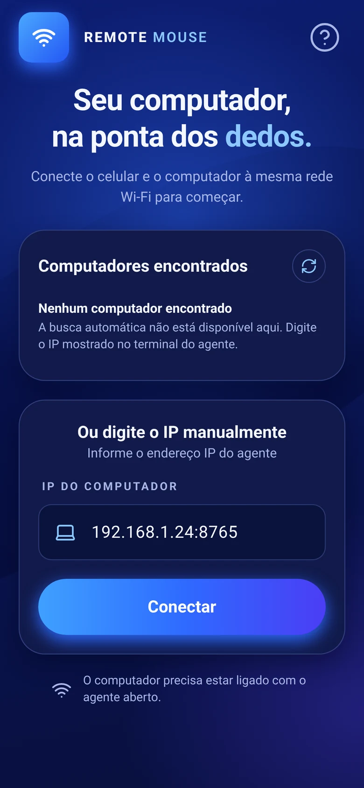
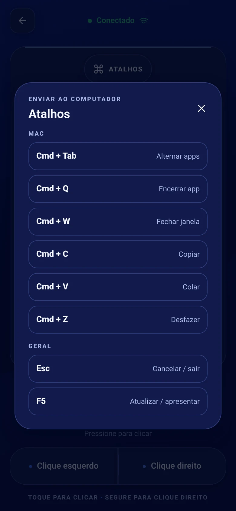

To use your phone as a wireless mouse for your Mac, install the ConnectMouse app on your phone and the ConnectMouse menu bar app on your Mac, allow the Mac app in **System Settings → Privacy & Security → Accessibility** and click **Start server**. With the phone and the Mac on the same Wi-Fi network, your Mac shows up in the phone app automatically. Tap it, and your phone screen becomes a trackpad with a keyboard, shortcuts and media keys.

The whole setup takes a few minutes and you only do it once. This guide walks through each step, explains what every permission is for and covers the problems people hit most often.

## What do you need before you start?

ConnectMouse has two parts: an app on your phone and a small app on your Mac that receives the commands. Check this list before installing anything.

- **A Mac running macOS 13 Ventura or later.** There are separate downloads for Apple Silicon (M1 and newer) and Intel Macs. Pick the one that matches your Mac.
- **An iPhone or Android phone** with the ConnectMouse app.
- **One Wi-Fi network for both devices.** The phone and the Mac must be on the same local network. A guest network that isolates devices from each other will not work.
- **A few seconds in System Settings** to approve the Accessibility permission.

You do not need Bluetooth, a USB cable, an account or an internet connection. Everything happens on your local network. If you are curious about what travels between the devices, read [how ConnectMouse works over local Wi-Fi](/blog/how-connectmouse-works-local-wifi-privacy/).

## How do you install ConnectMouse on your Mac?

The Mac app lives in the menu bar, next to the clock, instead of in the Dock. Install it like any other Mac app:

1. Download the DMG for your Mac (Apple Silicon or Intel) from the ConnectMouse download page.
2. Open the DMG and drag **ConnectMouse** to the **Applications** folder.
3. Eject the DMG and open the copy in **Applications** from Finder. Do not run the app from inside the mounted DMG, because macOS ties the Accessibility permission to the installed copy.
4. Look for the mouse icon in the menu bar. **Left-click** it to open the panel and **right-click** it for a menu with **Quit**.

<strong>First launch blocked?</strong> Current test builds are not notarized by Apple yet, so macOS may refuse to open the app the first time. If you downloaded it from the official ConnectMouse release page, go to <strong>System Settings → Privacy &amp; Security</strong> and choose <strong>Open Anyway</strong>. Never disable Gatekeeper to get around this.

The app has no Dock icon and does not start a server on its own. Nothing listens on your network until you click **Start server**.

## How do you allow Accessibility permission on Mac?

The first time you open the panel, ConnectMouse shows a full-screen notice instead of the dashboard. That is on purpose: macOS only lets approved apps move the pointer, click and type, so there is no point in starting a server the Mac would ignore.

1. In the panel, click **Open Accessibility settings**. System Settings opens on **Privacy & Security → Accessibility**.
2. Turn on the entry for the app. Depending on the build, macOS may list it as **ConnectMouse** or **Remote Mouse**, the project's original name.
3. Go back to the menu bar panel. You do not need to click anything: the app checks the permission every two seconds and unlocks the dashboard as soon as the input agent inside the app is authorized.

The permission belongs to the agent that actually sends mouse and keyboard events, not just to the window you see. If macOS ever asks for the agent executable separately, use **Show helper in Finder** in the notice and add it with the **+** button in System Settings.

<strong>What ConnectMouse does not ask for:</strong> camera, screen recording, input monitoring and administrator privileges are not needed. If you revoke Accessibility later, the notice comes back and the server stops automatically.

## How do you connect your phone to your Mac?

Once the dashboard is unlocked, the panel shows your Mac's name, its local IPv4 addresses and port **8765**.

1. Click **Start server**. The status changes from *Starting…* to **Ready to connect!** and the panel reports *Waiting for your phone*.
2. If macOS asks to allow **Local Network** access or incoming connections, allow them. They are what let the phone find and reach your Mac.
3. Open ConnectMouse on your phone. Your Mac appears in the list of computers found on the network. Tap it.
4. The Mac panel switches to **Connected!** and shows *Phone connected via WebSocket*. The phone opens the touchpad.

*Computers found on your Wi-Fi appear at the top; the field below connects to an address you type by hand.*

### What if automatic discovery does not find your Mac?

Automatic discovery uses Bonjour-style mDNS, which some routers and corporate networks block. You can always connect manually: type one of the IP addresses shown in the Mac panel into the phone app, for example `192.168.1.24`. The port defaults to `8765`, and you can also type it as `192.168.1.24:8765`. **Copy address** in the panel puts the full address on your clipboard. Use the Wi-Fi address, not one that belongs to a VPN.

## How do you use the trackpad, keyboard and shortcuts?

The phone screen works like a Mac trackpad, with a few extra panels for the things a trackpad cannot do.

| Action on the phone | What happens on the Mac |
| --- | --- |
| Drag one finger | Moves the pointer |
| Tap | Left click |
| Long press | Right click |
| Drag two fingers | Scrolls vertically and horizontally |
| Left / right buttons | Left and right click, as on a mouse |
| Keyboard button | Types on the Mac in real time, including Backspace and Enter |

**Shortcuts.** The shortcuts sheet has a Mac group with **Cmd + Tab**, **Cmd + Q**, **Cmd + W**, **Cmd + C**, **Cmd + V** and **Cmd + Z**, plus **Esc** and **F5**. When the phone connects, the Mac tells it which system it runs, so the sheet shows the Mac shortcuts with **Cmd** instead of the Windows ones. If the computer cannot be identified, the sheet asks you to pick Mac, Windows or Linux first.

**Media and volume.** The media panel controls play and pause, next, previous and the Mac's volume. On Android, the phone's physical volume buttons can change the Mac's volume instead of the phone's while you are connected. On iPhone this works on a best-effort basis. macOS has no "stop" media key, so that button does nothing on a Mac.

**Sensitivity.** If the pointer feels slow or jumpy, open the sensitivity control. It ranges from 0.5× to 6×, starts at 3× and is saved on the phone.

*Mac shortcuts are one tap away, so you never have to reach for the keyboard during a presentation.*

## How do you fix common problems?

Most issues come down to the network or to a permission. Work through the one that matches what you see.

### The panel stays on the Accessibility notice

- Make sure you approved the copy in **/Applications** and opened it from Finder, not from the DMG or Terminal.
- If you replaced an older build, macOS may keep an outdated entry. Remove only that entry in Accessibility settings and add the current app with **+**.
- Use **Copy permission diagnostics** in the notice if it still does not unlock. It copies the app and agent paths, the permission results and public signature details, nothing else, which is what you need for a bug report on [GitHub Issues](https://github.com/daviixs/wifi-mouse/issues).

### The phone cannot find or reach the Mac

- Confirm the server is running and the panel says **Online**.
- Put both devices on the same Wi-Fi network and turn off VPNs on either side while testing.
- Check **System Settings → Privacy & Security → Local Network** and the macOS Firewall, then connect by IP as described above.

### "Port 8765 is already in use"

Another copy of the agent is probably running, for example one you started from Terminal. Quit it yourself, then click **Start server** again. ConnectMouse never kills a process it did not start.

## Is it safe to control your Mac from your phone?

ConnectMouse only accepts commands while you have the server running, works only on your local network and needs an explicit Accessibility approval. The connection has no pairing code or encryption yet, so anyone who can reach port 8765 on the same network could send input. Use it on networks you trust, like home or your office, and click **Stop server** before joining public Wi-Fi. The [privacy and architecture explainer](/blog/how-connectmouse-works-local-wifi-privacy/) goes into the details.

Using a Windows PC too? The same phone app works with the [ConnectMouse Windows tray app](/blog/use-phone-as-mouse-and-keyboard-windows-pc/), with the same gestures and its own Windows shortcuts.

## Ready to leave the trackpad on the desk?

Your phone is already in your hand during a presentation, on the couch in front of a Mac mini hooked up to the TV, or across the room from a Mac playing music. ConnectMouse turns it into the remote you were missing, for free and without accounts. Install the Mac app, allow Accessibility once and you are set.
